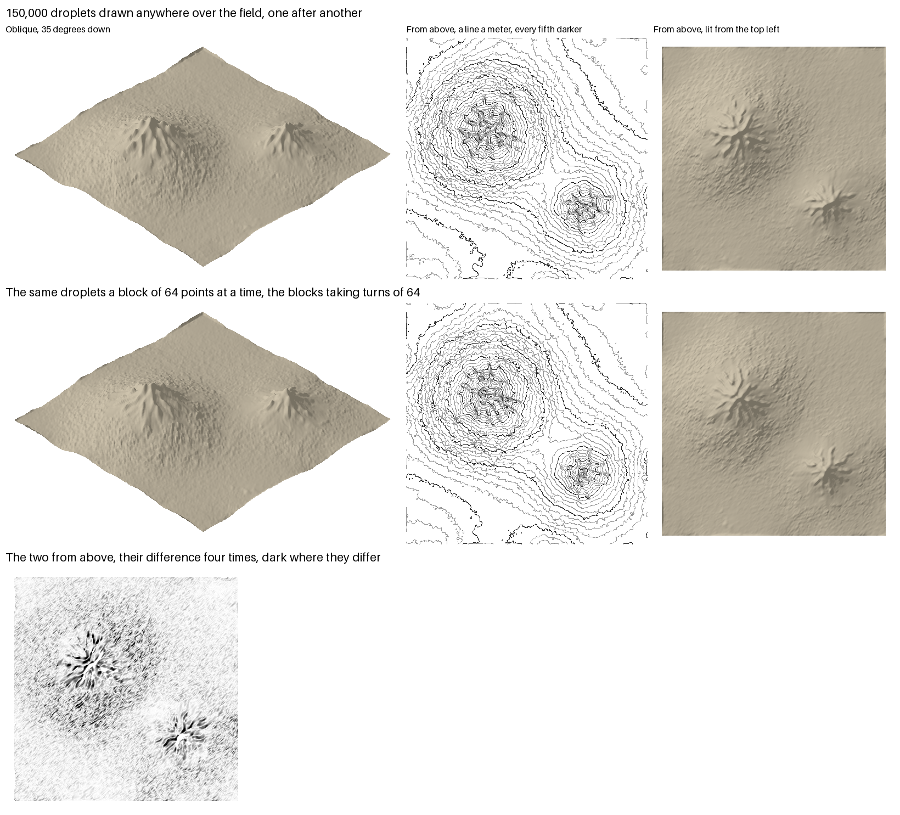
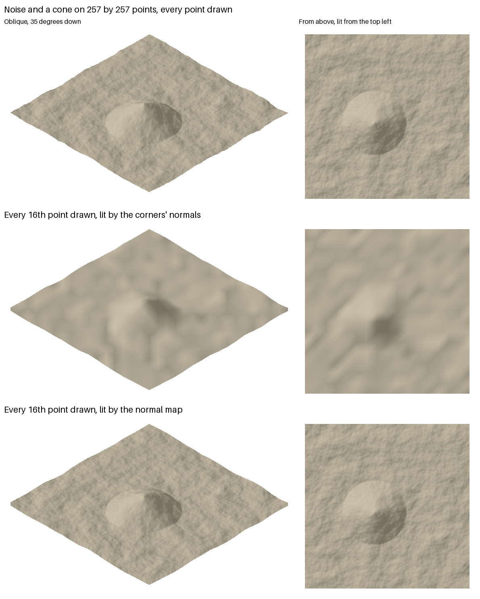
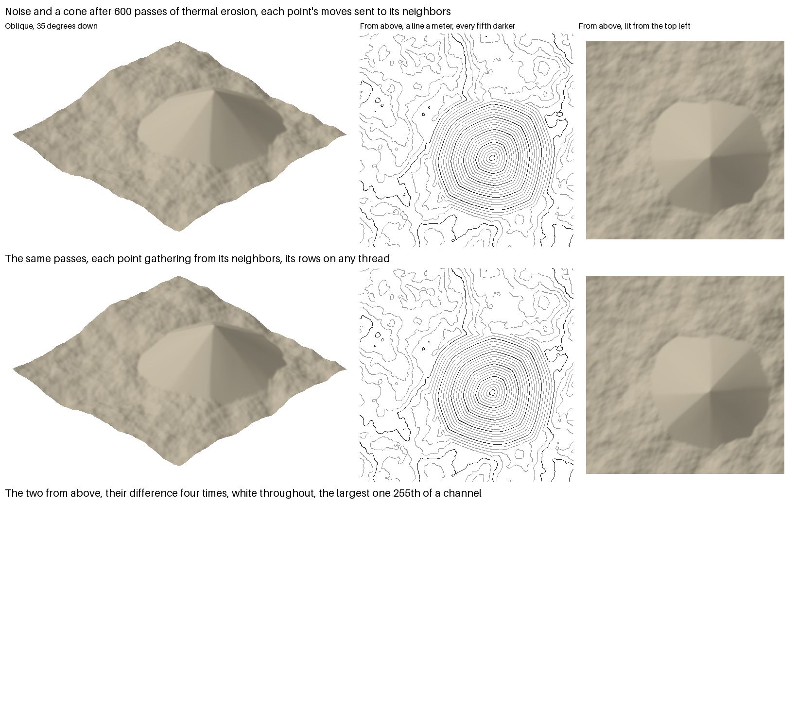
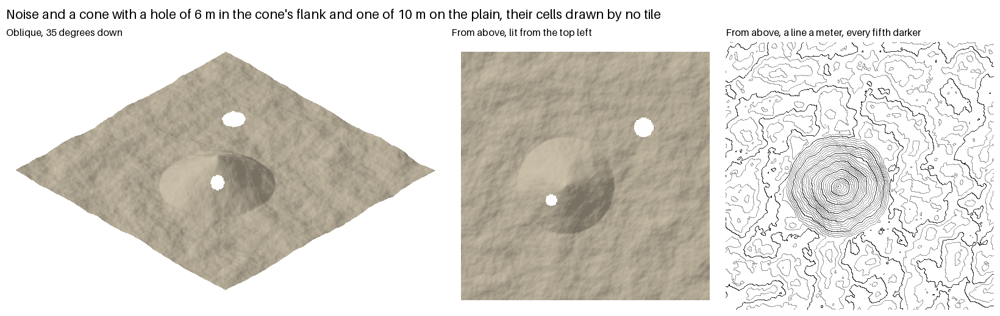
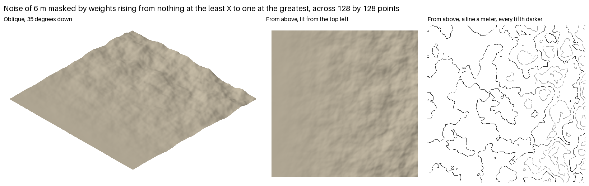

# Landscape devlog

What landed in Landscape, by day and newest first, with the pictures taken on the way, the captures
the repository keeps under `.github/assets` and the pictures made while an item was built, kept
under `.github/assets/readings` as WebP files named by their day, each on the day its name says, and
the notes written beside them as Markdown files named the same way. A line under Done names the item
of .github/REVIEW.md or .github/REVIEW-ARCHIVE.md and the commit that closed it.

## 2026-11-18

Three stamps on 129 by 129 points a meter apart, a dome of 18 m, a plateau at 8 m that replaces and
a crater of 6 m added over the corner, drawn from the module's own tiles on the CPU by
build/reading.cs, oblique and from above, lit by a sun 33 degrees high from the top left.

Noise and a cone of 36 m before thermal erosion, after 600 passes at a talus of 0.6 with each point
against the four beside it along X and Z, which slumps the cone into a square pyramid whose diagonal
faces stand at the square root of two times the talus, and against the eight about it with the
diagonals over the square root of two, which leaves eight faces, oblique, lit from above and in
contours of a meter.

The splat map's four materials over three stamps, noise and a steep cone, sand below 1 m, grass to
12 m, rock above a steepness of 0.7 and snow above 14 m, each blending into the next and blended in
the picture by their weights, oblique, from above and in contours.

Noise, a dome of 40 m and a cone of 30 m on 193 by 193 points before hydraulic erosion, after
150,000 droplets reckoned against 40 m with the edge worn by every droplet leaving over it and
filled by none, which dug pits without end, and after the same droplets with the edge held as the
base level, which cuts gullies down both hills and fills their feet, oblique, lit from above and in
contours of a meter.

Trees kept from a place every 1.5 m on the splat ground by a rule of grass from 1 to 12 m no steeper
than 0.4 and the grass's weight as their density, each a dark point, standing on the plateau, the
dome's grass and the crater's rim and on no rock, sand or snow.

A picture of a ridge with a valley across it, 64 by 32 texels given through ILandscapePictures,
stamped over 80 by 40 m at 18 m by the higher over noise and over 40 by 20 m at 6 m added to a dome,
each faded in over its edge, oblique, from above and in contours.

An every-step recipe at 513, 1,025, 2,049 and 4,097 points a side, the fastest of three runs' time a
point of each stage and the bytes a point it allocates, the tiles' 57 bytes a point with an index
array a tile falling to 33 with one shared a size.

Tiles of noise and a cone drawn at a step by their distance, every point near in sand, every fourth
in blue and every sixteenth in red, with no skirts, where white cracks run along the borders between
steps, and with skirts hung for the coarsest step, where none does.

150,000 droplets on noise, a dome and a cone, drawn anywhere over the field and a block of 64 points
at a time with the blocks taking turns of 64 droplets, oblique, in contours and lit from above, and
their difference four times, the hills, the count of their gullies and the plains alike and the
difference darkest along single gullies, which run in other places.

Noise and a cone on 257 by 257 points drawn at every point, at every 16th point lit by its tiles'
corners' normals, where the ridges between the corners blur into one slope, and at every 16th lit by
the normal map sampled per pixel, where the field's own detail stands on the coarse tiles and the
outline alone is coarse.

Noise and a cone after 600 passes of thermal erosion at a talus of 0.6, each point's moves sent to
its neighbors and each point gathering its share from them, oblique, in contours and lit from above,
and their difference four times, white throughout since the two differ by one 255th of a channel at
most.

Noise and a cone with a hole of 6 m in the cone's flank and one of 10 m on the plain, the white
ground showing through where no tile draws a cell, oblique and lit from above, and the contours from
above running through both since a hole keeps the heights the steps left.

Noise of 6 m masked by a picture of weights rising from nothing at the least X to one at the
greatest across 128 by 128 points, the ground flat at one side, the noise whole at the other and a
share of it between, oblique, lit from above and in contours.

# The cost of a build by step

An every-step recipe built at 513, 1,025, 2,049 and 4,097 points a side, a step at a time through a
builder's rebuild less its own overhead, each stage the fastest of three runs after a first pass at
513 that is not reported, on a desktop of 32 threads under the machine's exclusive lock
(`dotnet run -c Release --no-cache build/bench.cs -- <numbers.json>`). The droplets are a quarter a
point and the passes fixed, so a stage in proportion to its field holds its time and its bytes a
point level.

Every stage allocates the same bytes a point at every size. The tiles allocated 57 bytes a point,
24 of them an index array a tile though every whole tile's indices are the same, and with one array
shared a size they allocate 33, 957 MB at 4,097 a side falling to 554. Hydraulic erosion's time a
point rises at 4,097, 583 ns where it is 400 to 434 below, its droplets reaching across a field of
67 MB that no cache holds. The noise and the splat map grow cheaper a point as the field grows,
since the bench widens the noise with the field, and a wider noise puts more neighboring points in
one cell of its lattice, whose gradient and materials then repeat from point to point. A whole build
of the seven steps takes 19.0 s at 4,097 a side, 1,130 ns a point, and allocates 12 bytes a point, the
field and the two scratch fields smoothing and thermal erosion take.

| Side | Stage | ms | MB allocated | ns a point | bytes a point |
|---:|---|---:|---:|---:|---:|
| 513 | rebuild overhead | 1 | 2.1 | 4.0 | 8.00 |
| 513 | Stamp | 0 | -0.0 | 1.7 | -0.00 |
| 513 | PictureStamp | 1 | 0.0 | 4.0 | 0.00 |
| 513 | Noise | 74 | 0.0 | 282.4 | 0.01 |
| 513 | Terrace | 1 | 0.0 | 3.9 | 0.00 |
| 513 | Smoothing | 1 | 1.1 | 4.4 | 4.00 |
| 513 | ThermalErosion | 100 | 1.1 | 380.4 | 4.00 |
| 513 | HydraulicErosion | 105 | 0.0 | 399.8 | 0.01 |
| 513 | tiles | 7 | 8.7 | 25.0 | 32.91 |
| 513 | splat map | 38 | 5.3 | 145.7 | 20.00 |
| 513 | whole build | 290 | 3.2 | 1101.7 | 12.02 |
| 1025 | rebuild overhead | 5 | 8.4 | 4.5 | 8.00 |
| 1025 | Stamp | 2 | -0.0 | 1.5 | -0.00 |
| 1025 | PictureStamp | 4 | 0.0 | 3.3 | 0.00 |
| 1025 | Noise | 255 | 0.0 | 242.3 | 0.00 |
| 1025 | Terrace | 4 | 0.0 | 3.7 | 0.00 |
| 1025 | Smoothing | 7 | 4.2 | 6.6 | 4.00 |
| 1025 | ThermalErosion | 430 | 4.2 | 409.7 | 4.00 |
| 1025 | HydraulicErosion | 438 | 0.0 | 416.9 | 0.00 |
| 1025 | tiles | 22 | 34.6 | 20.7 | 32.98 |
| 1025 | splat map | 94 | 21.0 | 89.4 | 20.00 |
| 1025 | whole build | 1102 | 12.6 | 1048.9 | 12.00 |
| 2049 | rebuild overhead | 19 | 33.6 | 4.6 | 8.00 |
| 2049 | Stamp | 11 | -0.0 | 2.6 | -0.00 |
| 2049 | PictureStamp | 15 | 0.0 | 3.5 | 0.00 |
| 2049 | Noise | 778 | 0.0 | 185.4 | 0.00 |
| 2049 | Terrace | 15 | 0.0 | 3.6 | 0.00 |
| 2049 | Smoothing | 27 | 16.8 | 6.4 | 4.00 |
| 2049 | ThermalErosion | 1671 | 16.8 | 398.1 | 4.00 |
| 2049 | HydraulicErosion | 1821 | 0.0 | 433.7 | 0.00 |
| 2049 | tiles | 72 | 138.6 | 17.2 | 33.01 |
| 2049 | splat map | 239 | 84.0 | 56.9 | 20.00 |
| 2049 | whole build | 4305 | 50.4 | 1025.3 | 12.00 |
| 4097 | rebuild overhead | 85 | 134.3 | 5.1 | 8.00 |
| 4097 | Stamp | 37 | -0.0 | 2.2 | -0.00 |
| 4097 | PictureStamp | 59 | 0.0 | 3.5 | 0.00 |
| 4097 | Noise | 2414 | 0.0 | 143.8 | 0.00 |
| 4097 | Terrace | 37 | 0.0 | 2.2 | 0.00 |
| 4097 | Smoothing | 84 | 67.1 | 5.0 | 4.00 |
| 4097 | ThermalErosion | 6674 | 67.1 | 397.6 | 4.00 |
| 4097 | HydraulicErosion | 9779 | 0.0 | 582.6 | 0.00 |
| 4097 | tiles | 337 | 554.4 | 20.1 | 33.03 |
| 4097 | splat map | 1013 | 335.7 | 60.4 | 20.00 |
| 4097 | whole build | 18970 | 201.4 | 1130.2 | 12.00 |

# Droplets a block at a time

Hydraulic erosion's time a point, the droplets a quarter a point, read with the droplets drawn
anywhere over the field (A) and a block of 64 points at a time, the blocks taking turns of 64 (B),
the two programs built from the same source with the block set to the whole field for A and run
one after the other under the machine's exclusive lock, the fastest of three runs each
(`dotnet run -c Release --no-cache build/bench.cs -- <numbers.json> 2049 4097`). The machine
carried a load of 15 from other sessions' work, which the lock does not keep off the processor,
so the two are read in turn rather than against the morning's table.

| Order | Round | 2,049 a side, ns a point | 4,097 a side, ns a point |
|---|---:|---:|---:|
| A, anywhere | 1 | 495.6 | 641.9 |
| B, blocks | 1 | 397.2 | 402.9 |
| A, anywhere | 2 | 430.7 | 592.8 |

Drawn anywhere, a droplet at 4,097 a side cost 30 and 38 hundredths more a point than at 2,049,
its field of 67 MB read afresh from memory. A block at a time, it costs the same at both sizes, and
37 hundredths less than drawn anywhere at 4,097 in the same round. The second round's B was stopped
to free the lock for a session waiting behind it.

# Thermal erosion gathered across threads

Thermal erosion's time and bytes a point, 20 passes, at 1,025 and 4,097 points a side, on one
thread and on eight, the fastest of three runs each after a first pass at 513 that is not
reported, under the machine's exclusive lock (`dotnet run -c Release --no-cache build/bench.cs --
<numbers.json> 1025 4097`), with the machine carrying a load of some 24 from other sessions' work.

| Side | Stage | ms | ns a point | bytes a point |
|---:|---|---:|---:|---:|
| 1,025 | thermal erosion, one thread | 473 | 450.0 | 12.00 |
| 1,025 | thermal erosion, eight threads | 74 | 70.1 | 12.11 |
| 1,025 | whole build, one thread | 1,172 | 1,116.0 | 20.02 |
| 1,025 | whole build, eight threads | 549 | 522.7 | 20.14 |
| 4,097 | thermal erosion, one thread | 7,465 | 444.7 | 12.00 |
| 4,097 | thermal erosion, eight threads | 1,160 | 69.1 | 12.01 |
| 4,097 | whole build, one thread | 16,690 | 994.3 | 20.01 |
| 4,097 | whole build, eight threads | 8,605 | 512.6 | 20.02 |

Gathered, a pass reckons what leaves every point into a field, the excess it is shared by into a
second and the moves into a third, 12 bytes a point where the moves alone took 4, so a whole build
allocates 20 bytes a point where it allocated 12. On eight threads thermal erosion runs 6.4 times as
fast at 4,097 a side and a whole build twice as fast, the droplets on one thread taking the rest.

# A build across threads

An every-step recipe built at 1,025 and 4,097 points a side on one thread and on eight, the
fastest of three runs each after a first pass at 513 that is not reported, under the machine's
exclusive lock (`dotnet run -c Release --no-cache build/bench.cs -- <numbers.json> 1025 4097`).
The machine carried a load of 24 on its 32 threads from other sessions' work, which the lock does
not keep off the processor, so few threads stood free for the build's.

Eight threads built 1,025 a side in 922 ms where one took 1,147, and 4,097 a side in 16.7 s where
one took 16.5. The steps whose rows run across the threads, the stamps, the noise, the terraces and
the smoothing, take some 2.7 s of the 16.5 at 4,097, the noise 2.5 of them, and the two erosions,
which run on one thread, the rest, so the build's time stands on the erosions. The bits are the
same at every count, which the tests hold.

| Side | Stage | ms | MB allocated | ns a point | bytes a point |
|---:|---|---:|---:|---:|---:|
| 1025 | rebuild overhead | 5 | 8.4 | 5.0 | 8.00 |
| 1025 | Stamp | 1 | 0.0 | 1.3 | 0.00 |
| 1025 | PictureStamp | 3 | 0.0 | 2.6 | 0.00 |
| 1025 | Noise | 258 | 0.0 | 245.7 | 0.00 |
| 1025 | Terrace | 3 | 0.0 | 2.8 | 0.00 |
| 1025 | Smoothing | 7 | 4.2 | 6.4 | 4.00 |
| 1025 | ThermalErosion | 443 | 4.2 | 421.5 | 4.00 |
| 1025 | HydraulicErosion | 442 | 0.0 | 420.9 | 0.01 |
| 1025 | tiles | 27 | 35.4 | 25.3 | 33.70 |
| 1025 | splat map | 64 | 21.0 | 60.6 | 20.00 |
| 1025 | whole build | 1147 | 12.6 | 1091.5 | 12.02 |
| 1025 | whole build, 8 threads | 922 | 12.6 | 877.3 | 12.03 |
| 4097 | rebuild overhead | 77 | 134.3 | 4.6 | 8.00 |
| 4097 | Stamp | 42 | 0.0 | 2.5 | 0.00 |
| 4097 | PictureStamp | 57 | 0.0 | 3.4 | 0.00 |
| 4097 | Noise | 2481 | 0.0 | 147.8 | 0.00 |
| 4097 | Terrace | 53 | 0.0 | 3.1 | 0.00 |
| 4097 | Smoothing | 118 | 67.1 | 7.0 | 4.00 |
| 4097 | ThermalErosion | 6895 | 67.1 | 410.8 | 4.00 |
| 4097 | HydraulicErosion | 7090 | 0.2 | 422.4 | 0.01 |
| 4097 | tiles | 394 | 566.5 | 23.5 | 33.75 |
| 4097 | splat map | 969 | 335.7 | 57.7 | 20.00 |
| 4097 | whole build | 16459 | 201.6 | 980.5 | 12.01 |
| 4097 | whole build, 8 threads | 16714 | 201.6 | 995.7 | 12.01 |

Commits that day

- `b78880b` A density map gives itself as a picture of its shares, so a masked step weighs each
  point by a splat material or a painted density with no picture file.
- `e053e31` A step can be masked by a picture of weights over a rectangle, so it changes each point
  by its weight and leaves the ground outside as it stood.
- `e4894ca` The review holds a handoff of what the module holds, what waits on the owner and what to
  read first, and the tests take the module checks of the latest Tools.
- `c0ed588` A hole marks the cells within its radius, which no tile draws and no ray meets, for a
  cave's or a tunnel's mouth an engine fills, the heights kept and the cells given to its physics.
- `6184a79` Thermal erosion gathers each point's share from its neighbors in one order, so its rows
  run on any thread with the same bits and it runs 6.4 times as fast on eight at 4,097 points a
  side.
- `adc1b7d` A normal map gives the field's normal at every point as a texture, written again over a
  change, so a tile drawn far off at a coarse step is lit by the field's own detail.
- `9c9e44c` A build shares the rows of every step whose points are reckoned alone among the threads
  its options allow, the same bits at any count, and reports each step it applies.
- `f1cf785` The droplets run a block of the field at a time in turns, so at 4,097 points a side they
  cost 403 ns a point where drawn anywhere they cost 642, and the eroded field differs in where each
  gully runs alone.
- `70a2fbd` A splat map is weighed again over a change and the points beside it alone and gives the
  rectangle an engine uploads, where a rebuild made the whole map again.
- `1d99296` A ray meets the ground the tiles draw, walked a cell at a time over the field, so an
  editor places a stamp where the pointer falls and a game drops what falls.
- `8f13181` A tile holds its bounds and is drawn at a coarser step with a skirt hung below its
  edges, so tiles at different steps meet with no crack, and the module gives the error in meters a
  step leaves.
- `1d73936` A bench times and weighs every step at four sizes, the tiles of one size share one index
  array where each held its own, so they allocate 33 bytes a point where they allocated 57, and the
  text names no engine.
- `01fe17d` A recipe is written and read as JSON that builds the same bits, picture stamps take
  their heights through ILandscapePictures, the one interface the module declares, and the README
  says so where it said none.
- `e619901` Placement keeps the places and seeds a planting gives by ranges of height and steepness
  and a density map, lifting each onto the ground with its normal, and the devlog is linked from the
  README and named with its command.
- `a503f2a` The tests take the checks every module keeps from the Tools submodule in place of their
  own copy, which found the README naming no LandscapeStep, and a clone without the submodule stops
  with the command that fetches it.
- `3629660` A test holds a hill of 40 m and one of 160 m, each eroded against its own height, to 84
  hundredths of its peak and 500 pits, where against 1 m a hill keeps 80 and is pitted at 749
  points.
- `2fef9bd` Hydraulic erosion runs droplets that cut channels and fill the feet of slopes, their
  fall reckoned against 40 m and the field's edge held as a base level, which a ramp draining off it
  was dug 16.4 m below before and 0.009 m after.
- `b491389` A host with no engine runs the README's smallest binding word for word, and a test holds
  the README's block to the lines it runs.
- `b399737` The README says how any engine binds the module, its conventions of units, axes, winding
  and layers, the swap an engine of other axes makes, and the smallest binding.
- `e4b7cb5` A splat map weighs up to eight materials at every point by ranges of height and
  steepness, its weights summing to one and its RGBA layers of four materials summing to 255.
- `ea1bc5d` The library builds as the assembly and package 3DEngine.Landscape and its tests as
  3DEngine.Landscape.Tests, the namespace staying Landscape.
- `952f49b` The recipe gains noise, terraces, smoothing and thermal erosion over eight neighbors,
  which hold a slope to 1.08 times its talus where four held it to 1.41, and a builder that applies
  a changed recipe again from its first changed step and names the points and tiles it changed.
- `da8f91e` The module holds a heightfield built from a recipe of stamps and cut into tiles of
  triangles, with a test that holds every comment line to 100 columns and the skeleton's long lines
  wrapped.

## 2026-11-17

Commits that day

- `34c3b63` The ignore file's note on the pictures folder names no one, and the guides spell
  canceled.

## 2026-10-31

Done that day

- Item 1 at `81d2ba2`. The documents, one commit.
- Item 2 at `35effea`. The skeleton, one commit after item 1.

Commits that day

- `35effea` The module gains its solution, an empty library whose public members need summaries, a
  test that it loads, the version at 0.1 and a build workflow on Linux, Windows and macOS.
- `81d2ba2` The module gains its documents, AGENTS.md, the README, STYLE.md, COMMITS.md and the code
  of conduct as the engines keep them, with git's ignore and attribute files.
