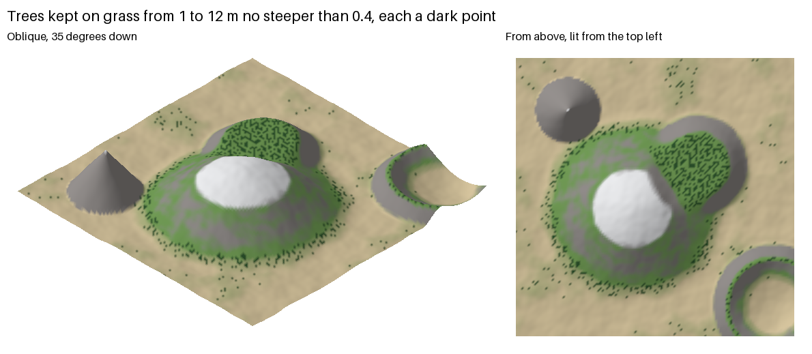
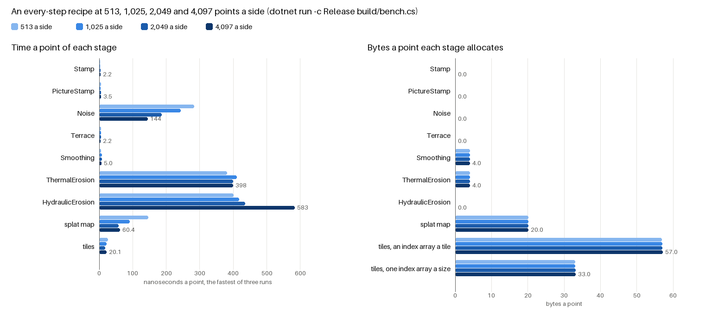
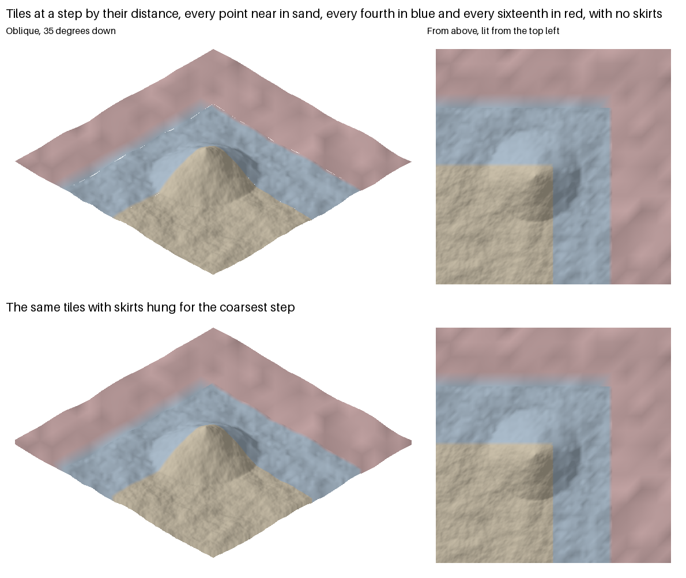

# Landscape devlog

What landed in Landscape, by day and newest first, with the pictures taken on the way, the captures
the repository keeps under `.github/assets` and the pictures made while an item was built, kept
under `.github/assets/readings` as WebP files named by their day, each on the day its name says, and
the notes written beside them as Markdown files named the same way. A line under Done names the item
of .github/REVIEW.md or .github/REVIEW-ARCHIVE.md and the commit that closed it.

## 2026-11-18

Three stamps on 129 by 129 points a meter apart, a dome of 18 m, a plateau at 8 m that replaces and
a crater of 6 m added over the corner, drawn from the module's own tiles on the CPU by
build/reading.cs, oblique and from above, lit by a sun 33 degrees high from the top left.

Noise and a cone of 36 m before thermal erosion, after 600 passes at a talus of 0.6 with each point
against the four beside it along X and Z, which slumps the cone into a square pyramid whose diagonal
faces stand at the square root of two times the talus, and against the eight about it with the
diagonals over the square root of two, which leaves eight faces, oblique, lit from above and in
contours of a meter.

The splat map's four materials over three stamps, noise and a steep cone, sand below 1 m, grass to
12 m, rock above a steepness of 0.7 and snow above 14 m, each blending into the next and blended in
the picture by their weights, oblique, from above and in contours.

Noise, a dome of 40 m and a cone of 30 m on 193 by 193 points before hydraulic erosion, after
150,000 droplets reckoned against 40 m with the edge worn by every droplet leaving over it and
filled by none, which dug pits without end, and after the same droplets with the edge held as the
base level, which cuts gullies down both hills and fills their feet, oblique, lit from above and in
contours of a meter.

Trees kept from a place every 1.5 m on the splat ground by a rule of grass from 1 to 12 m no steeper
than 0.4 and the grass's weight as their density, each a dark point, standing on the plateau, the
dome's grass and the crater's rim and on no rock, sand or snow.

A picture of a ridge with a valley across it, 64 by 32 texels given through ILandscapePictures,
stamped over 80 by 40 m at 18 m by the higher over noise and over 40 by 20 m at 6 m added to a dome,
each faded in over its edge, oblique, from above and in contours.

An every-step recipe at 513, 1,025, 2,049 and 4,097 points a side, the fastest of three runs' time a
point of each stage and the bytes a point it allocates, the tiles' 57 bytes a point with an index
array a tile falling to 33 with one shared a size.

Tiles of noise and a cone drawn at a step by their distance, every point near in sand, every fourth
in blue and every sixteenth in red, with no skirts, where white cracks run along the borders between
steps, and with skirts hung for the coarsest step, where none does.

# The cost of a build by step

An every-step recipe built at 513, 1,025, 2,049 and 4,097 points a side, a step at a time through a
builder's rebuild less its own overhead, each stage the fastest of three runs after a first pass at
513 that is not reported, on a desktop of 32 threads under the machine's exclusive lock
(`dotnet run -c Release --no-cache build/bench.cs -- <numbers.json>`). The droplets are a quarter a
point and the passes fixed, so a stage in proportion to its field holds its time and its bytes a
point level.

Every stage allocates the same bytes a point at every size. The tiles allocated 57 bytes a point,
24 of them an index array a tile though every whole tile's indices are the same, and with one array
shared a size they allocate 33, 957 MB at 4,097 a side falling to 554. Hydraulic erosion's time a
point rises at 4,097, 583 ns where it is 400 to 434 below, its droplets reaching across a field of
67 MB that no cache holds. The noise and the splat map grow cheaper a point as the field grows,
since the bench widens the noise with the field, and a wider noise puts more neighboring points in
one cell of its lattice, whose gradient and materials then repeat from point to point. A whole build
of the seven steps takes 19.0 s at 4,097 a side, 1,130 ns a point, and allocates 12 bytes a point, the
field and the two scratch fields smoothing and thermal erosion take.

| Side | Stage | ms | MB allocated | ns a point | bytes a point |
|---:|---|---:|---:|---:|---:|
| 513 | rebuild overhead | 1 | 2.1 | 4.0 | 8.00 |
| 513 | Stamp | 0 | -0.0 | 1.7 | -0.00 |
| 513 | PictureStamp | 1 | 0.0 | 4.0 | 0.00 |
| 513 | Noise | 74 | 0.0 | 282.4 | 0.01 |
| 513 | Terrace | 1 | 0.0 | 3.9 | 0.00 |
| 513 | Smoothing | 1 | 1.1 | 4.4 | 4.00 |
| 513 | ThermalErosion | 100 | 1.1 | 380.4 | 4.00 |
| 513 | HydraulicErosion | 105 | 0.0 | 399.8 | 0.01 |
| 513 | tiles | 7 | 8.7 | 25.0 | 32.91 |
| 513 | splat map | 38 | 5.3 | 145.7 | 20.00 |
| 513 | whole build | 290 | 3.2 | 1101.7 | 12.02 |
| 1025 | rebuild overhead | 5 | 8.4 | 4.5 | 8.00 |
| 1025 | Stamp | 2 | -0.0 | 1.5 | -0.00 |
| 1025 | PictureStamp | 4 | 0.0 | 3.3 | 0.00 |
| 1025 | Noise | 255 | 0.0 | 242.3 | 0.00 |
| 1025 | Terrace | 4 | 0.0 | 3.7 | 0.00 |
| 1025 | Smoothing | 7 | 4.2 | 6.6 | 4.00 |
| 1025 | ThermalErosion | 430 | 4.2 | 409.7 | 4.00 |
| 1025 | HydraulicErosion | 438 | 0.0 | 416.9 | 0.00 |
| 1025 | tiles | 22 | 34.6 | 20.7 | 32.98 |
| 1025 | splat map | 94 | 21.0 | 89.4 | 20.00 |
| 1025 | whole build | 1102 | 12.6 | 1048.9 | 12.00 |
| 2049 | rebuild overhead | 19 | 33.6 | 4.6 | 8.00 |
| 2049 | Stamp | 11 | -0.0 | 2.6 | -0.00 |
| 2049 | PictureStamp | 15 | 0.0 | 3.5 | 0.00 |
| 2049 | Noise | 778 | 0.0 | 185.4 | 0.00 |
| 2049 | Terrace | 15 | 0.0 | 3.6 | 0.00 |
| 2049 | Smoothing | 27 | 16.8 | 6.4 | 4.00 |
| 2049 | ThermalErosion | 1671 | 16.8 | 398.1 | 4.00 |
| 2049 | HydraulicErosion | 1821 | 0.0 | 433.7 | 0.00 |
| 2049 | tiles | 72 | 138.6 | 17.2 | 33.01 |
| 2049 | splat map | 239 | 84.0 | 56.9 | 20.00 |
| 2049 | whole build | 4305 | 50.4 | 1025.3 | 12.00 |
| 4097 | rebuild overhead | 85 | 134.3 | 5.1 | 8.00 |
| 4097 | Stamp | 37 | -0.0 | 2.2 | -0.00 |
| 4097 | PictureStamp | 59 | 0.0 | 3.5 | 0.00 |
| 4097 | Noise | 2414 | 0.0 | 143.8 | 0.00 |
| 4097 | Terrace | 37 | 0.0 | 2.2 | 0.00 |
| 4097 | Smoothing | 84 | 67.1 | 5.0 | 4.00 |
| 4097 | ThermalErosion | 6674 | 67.1 | 397.6 | 4.00 |
| 4097 | HydraulicErosion | 9779 | 0.0 | 582.6 | 0.00 |
| 4097 | tiles | 337 | 554.4 | 20.1 | 33.03 |
| 4097 | splat map | 1013 | 335.7 | 60.4 | 20.00 |
| 4097 | whole build | 18970 | 201.4 | 1130.2 | 12.00 |

## 2026-10-31

Done that day

- Item 1 at `81d2ba2`. The documents, one commit.
- Item 2 at `35effea`. The skeleton, one commit after item 1.
