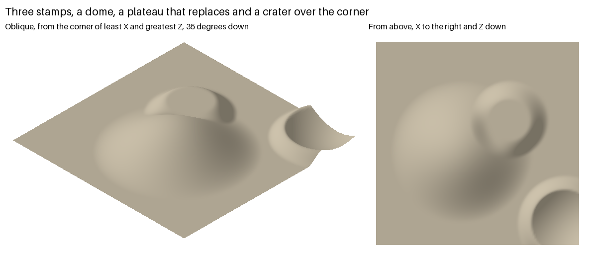

# Landscape devlog

What landed in Landscape, by day and newest first, with the pictures taken on the way, the captures
the repository keeps under `.github/assets` and the pictures made while an item was built, kept
under `.github/assets/readings` as WebP files named by their day, each on the day its name says, and
the notes written beside them as Markdown files named the same way. A line under Done names the item
of .github/REVIEW.md or .github/REVIEW-ARCHIVE.md and the commit that closed it.

## 2026-11-18

Three stamps on 129 by 129 points a meter apart, a dome of 18 m, a plateau at 8 m that replaces and
a crater of 6 m added over the corner, drawn from the module's own tiles on the CPU by
build/reading.cs, oblique and from above, lit by a sun 33 degrees high from the top left.

## 2026-10-31

Done that day

- Item 1 at `81d2ba2`. The documents, one commit.
- Item 2 at `35effea`. The skeleton, one commit after item 1.
